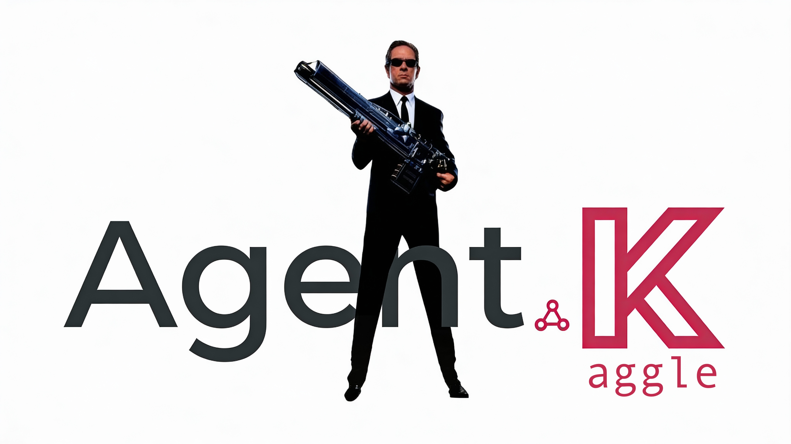

<div align="center">
  
  <h1>AGENT-K</h1>
  <p>Durable autonomous Kaggle missions with isolated ML workers</p>
</div>

AGENT-K discovers, researches, prototypes, evolves, and optionally submits generic Kaggle
solutions. A FastAPI control plane persists mission jobs and ordered events in PostgreSQL. Separate
workers run Pydantic-AI and Pydantic-Graph missions in isolated sandboxes, while immutable
checkpoints and results live in S3.

## Architecture

```text
Auth.js frontend ── signed user identity ──> FastAPI API ──> PostgreSQL
                                               │
                                               └──────────> S3 artifacts
Portable worker ── separate worker token ──────┘
       │
       └── mission subprocess: Discovery → Research → Prototype → Evolution → Submission
              └── each candidate runs in a pinned rootless Docker sandbox
```

The backend is a flat Python 3.13 package. It performs no import-time resource or model-provider
initialization. Mission state is durable and resumable; worker writes are lease-fenced; SSE streams
replay from `Last-Event-ID`; and artifacts are verified by size and SHA-256 before use.

## Requirements

- Python 3.13 and `uv`
- Node.js 20 and pnpm
- PostgreSQL
- S3 or a compatible object store with checksum support
- a pinned worker sandbox image
- Kaggle credentials and at least one supported model provider

## Install

```bash
cd backend
uv sync --all-extras

cd ../frontend
pnpm install --frozen-lockfile
```

Core API settings use the `AGENT_K_` prefix. At minimum the API needs
`AGENT_K_DATABASE_URL`, `AGENT_K_GATEWAY_SECRET`, and `AGENT_K_WORKER_TOKEN`. Artifact and
migration routes also require `AGENT_K_S3_BUCKET`. The frontend receives the same server-only
gateway secret. Workers receive the separate worker token, Kaggle/provider credentials, a dedicated
workspace root, and the pinned sandbox image; they do not receive database or storage credentials.

See the [installation guide](backend/docs/install.md) for the complete configuration matrix.

## Run

With the external services and environment configured:

```bash
./run.sh
```

Start a worker separately:

```bash
cd backend
.venv/bin/python -m agent_k.worker
```

The frontend is the supported user entry point. It signs the authenticated Auth.js user identity
before forwarding mission, competition, result, and stream requests. Protected API routes reject
unsigned browser calls.

Submissions are disabled by default. Both the service setting and mission criteria must explicitly
allow submission.

## Development

```bash
backend/.venv/bin/python -m ruff format --check backend
backend/.venv/bin/python -m ruff check backend
backend/.venv/bin/python -m mypy --config-file backend/pyproject.toml backend/agent_k
backend/.venv/bin/python -m pytest -v backend/tests
cd frontend && pnpm lint && pnpm build
cd ../backend && .venv/bin/python -m mkdocs build --strict
```

Tests use production parsers and service boundaries. PostgreSQL, S3, Kaggle, provider, and
end-to-end tests require their real configured services and skip explicitly when unavailable; they
are not replaced by mocks, fake clients, or synthetic ML rows.

## Documentation

The navigable MkDocs site lives under [`backend/docs`](backend/docs/index.md):

- [architecture](backend/docs/architecture.md)
- [HTTP and worker API](backend/docs/api.md)
- [event and SSE contract](backend/docs/events.md)
- [operations](backend/docs/operations.md)
- [legacy state migration](backend/docs/migration.md)
- [development standards](backend/docs/development.md)

## License

AGENT-K is licensed under the MIT License. See [LICENSE](LICENSE).
