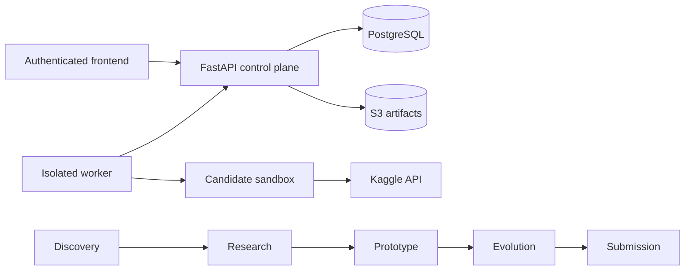

# AGENT-K

AGENT-K runs durable, resumable Kaggle missions through five phases:

The Python package is flat: every application module is directly under `agent_k`. The API is a
lightweight control plane; model providers, datasets, candidate execution, and Kaggle credentials
belong to isolated workers. PostgreSQL owns mission jobs, leases, snapshots, events, controls,
results, and migration ledgers. S3 stores immutable artifacts and migration sources.

## Guarantees

- Frontend requests carry a short-lived signed Auth.js user identity.
- Mission status, results, controls, and streams are restricted to the mission owner.
- Workers use a separate rotatable bearer token and every mutation is lease-fenced.
- Events are durable, globally ordered per mission, and replay from `Last-Event-ID`.
- Pause creates a durable checkpoint; resume uses its exact snapshot and artifacts.
- Artifact bytes are server-verified by size and SHA-256 before becoming available.
- External submission is disabled unless both service and mission settings allow it.
- Candidate evaluation uses real staged data; tests do not substitute mocks or synthetic rows.

Continue with [Installation](install.md), [Architecture](architecture.md), or the
[HTTP and worker API](api.md).
