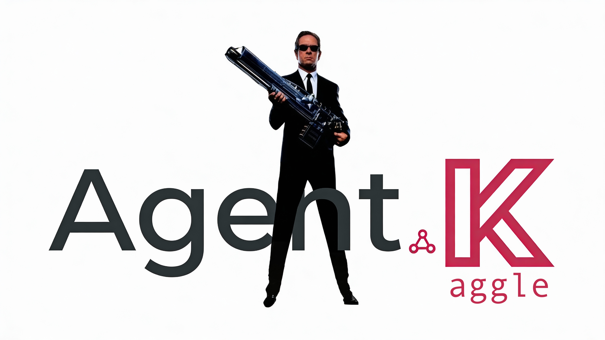

<div align="center">
  
  <h1>AGENT-K Mission Console</h1>
  <h3>Multi-Agent Kaggle GrandMaster (🧐)</h3>
  <p><em>Real-time dashboard for monitoring autonomous Kaggle competition missions</em></p>
</div>

<div align="center">
  <a href="https://nextjs.org/"></a>
  <a href="https://react.dev/"></a>
  <a href="https://tailwindcss.com/"></a>
</div>

---

## Overview

The AGENT-K Mission Console is a Next.js dashboard for real-time monitoring of autonomous Kaggle competition missions. It provides visualization of the multi-agent orchestration, evolution progress, tool calls, and mission state through the AG-UI protocol.

---

## Features

| Feature | Description |
|---------|-------------|
| **Mission Dashboard** | Real-time overview of mission phases, progress, and status |
| **Evolution Visualization** | Fitness charts tracking population improvement across generations |
| **Tool Call Inspection** | Detailed view of agent tool calls with thinking blocks and results |
| **Phase Cards** | Status cards for each mission phase (Discovery, Research, Prototype, Evolution, Submission) |
| **Memory View** | Inspection of agent memory entries and checkpoints |
| **Research View** | Display of leaderboard analysis and research findings |
| **Logs View** | Filterable log stream of mission events |

---

## Installation

### Prerequisites

- Node.js 20+
- pnpm

### Setup

```bash
cd frontend

# Install dependencies
pnpm install

# Set up environment variables
cp .env.example .env.local
# Edit .env.local with your configuration

# Run database migrations
pnpm db:migrate

# Start development server
pnpm dev
```

Your app should now be running on [localhost:3000](http://localhost:3000).

---

## Key Components

Located in `components/agent-k/`:

### Mission Dashboard

```
mission-dashboard.tsx    # Main dashboard container
├── phase-card.tsx       # Phase status cards
├── task-card.tsx        # Individual task cards
└── tool-call-card.tsx   # Tool call details with thinking
```

### Evolution View

```
evolution-view.tsx       # Evolution phase visualization
├── fitness-chart.tsx    # Fitness progression chart (Recharts)
└── [leaderboard submissions, convergence status]
```

### Research View

```
research-view.tsx        # Research findings display
├── leaderboard analysis
├── paper citations
└── strategy recommendations
```

### Memory View

```
memory-view.tsx          # Memory entries and checkpoints
├── session/persistent/global scopes
└── checkpoint restoration
```

### Logs View

```
logs-view.tsx            # Filterable event log
├── task status filters
└── tool type filters
```

### Plan View

```
plan-view.tsx            # Mission plan overview
├── phase objectives
└── task dependencies
```

### Quick Start

```
quick-start.tsx          # Empty-state onboarding panel
```

---

## State Management

### AG-UI Protocol

The frontend proxies Agent K requests through the AG-UI protocol, forwarding to the
Python backend SSE endpoint and transforming events into the Vercel AI data stream
consumed by the UI.

### Mission State Hook

```typescript
import { useAgentKState } from '@/hooks/use-agent-k-state';

function MissionDashboard() {
  const { mission, ui, dispatch } = useAgentKState();
  
  return (
    <div>
      <p>Phase: {mission.currentPhase}</p>
      <p>Progress: {mission.overallProgress}%</p>
    </div>
  );
}
```

### Type Definitions

All TypeScript types are defined in `lib/types/agent-k.ts`:

```typescript
// Core types
type MissionPhase = 'discovery' | 'research' | 'prototype' | 'evolution' | 'submission';
type TaskStatus = 'pending' | 'in_progress' | 'completed' | 'failed' | 'blocked' | 'skipped';

// Tool types
type ToolType = 'web_search' | 'kaggle_mcp' | 'code_executor' | 'memory' | 'browser';

// State interfaces
interface MissionState { ... }
interface EvolutionState { ... }
interface ResearchFindings { ... }
```

---

## Project Structure

```
frontend/
├── app/                        # Next.js app router
│   ├── (auth)/                 # Authentication routes
│   │   ├── login/              # Login page
│   │   └── register/           # Registration page
│   ├── (chat)/                 # Main chat/dashboard routes
│   │   ├── chat/               # Chat interface
│   │   ├── api/                # API routes
│   │   └── page.tsx            # Home page
│   ├── globals.css             # Global styles
│   └── layout.tsx              # Root layout
│
├── components/
│   ├── agent-k/                # AGENT-K specific components
│   │   ├── mission-dashboard.tsx
│   │   ├── phase-card.tsx
│   │   ├── task-card.tsx
│   │   ├── tool-call-card.tsx
│   │   ├── evolution-view.tsx
│   │   ├── fitness-chart.tsx
│   │   ├── research-view.tsx
│   │   ├── memory-view.tsx
│   │   ├── logs-view.tsx
│   │   ├── plan-view.tsx
│   │   └── quick-start.tsx
│   ├── ui/                     # Shared UI components (shadcn/ui)
│   └── elements/               # Custom elements
│
├── hooks/
│   ├── use-agent-k-state.tsx   # Mission state management
│   ├── use-artifact.ts         # Artifact handling
│   └── use-auto-resume.ts      # Mission resumption
│
├── lib/
│   ├── types/
│   │   ├── agent-k.ts          # AGENT-K TypeScript types
│   │   └── events.ts           # Event types
│   ├── ai/                     # AI SDK integration
│   ├── db/                     # Database (Drizzle ORM)
│   └── utils/                  # Utility functions
│
├── public/                     # Static assets
│
└── tests/                      # Playwright tests
    ├── e2e/                    # End-to-end tests
    └── pages/                  # Page objects
```

---

## Running Locally

### Development

```bash
pnpm dev          # Start with Turbopack
```

### Production Build

```bash
pnpm build        # Build for production
pnpm start        # Start production server
```

### Testing

```bash
pnpm test         # Run Playwright tests
```

### Linting

```bash
pnpm lint         # Check code style
pnpm format       # Fix code style
```

---

## Configuration

### Environment Variables

Create a `.env.local` file (see `.env.example`) with:

```bash
# Authentication
AUTH_SECRET="your-auth-secret"
AUTH_TRUST_HOST=true
AUTH_URL="http://localhost:3000"

# Database
POSTGRES_URL="postgresql://..."

# Agent K backend
PYTHON_BACKEND_URL="http://localhost:9000/agentic_generative_ui/"
AGENT_K_GATEWAY_SECRET="the-same-32-character-minimum-secret-as-the-backend"
AGENT_K_GATEWAY_ISSUER="agent-k-frontend"
AGENT_K_GATEWAY_AUDIENCE="agent-k-api"

# Optional integrations
ANTHROPIC_API_KEY="sk-ant-..."
BLOB_READ_WRITE_TOKEN="..."
REDIS_URL="redis://..."
```

### Database

The frontend uses PostgreSQL with Drizzle ORM:

```bash
pnpm db:generate  # Generate migrations
pnpm db:migrate   # Apply migrations
pnpm db:studio    # Open Drizzle Studio
```

---

## Connecting to Backend

### Backend URL

Agent K requests are forwarded in `app/(chat)/api/chat/route.ts` using
`PYTHON_BACKEND_URL` (defined in `lib/constants.ts`):

```typescript
export const PYTHON_BACKEND_URL =
  process.env.PYTHON_BACKEND_URL ||
  "http://localhost:9000/agentic_generative_ui/";
```

### Stream Bridge

The API route POSTs to the backend SSE endpoint and transforms the response into
Vercel AI data stream events for the UI:

```typescript
const backendResponse = await fetch(PYTHON_BACKEND_URL, { /* ... */ });
const transformedStream = transformAgentKStream(backendResponse.body!);
```

All frontend-to-backend Agent K requests carry a short-lived signed user identity.
The frontend and backend must share `AGENT_K_GATEWAY_SECRET`, issuer, and audience
values. The browser never receives that gateway secret.

### Deployment Revision

`GET /api/version` is public and returns the request-time Render revision without
requiring a session or cookie:

```json
{"revision":"<RENDER_GIT_COMMIT>"}
```

The value is `null` outside Render when `RENDER_GIT_COMMIT` is unset. Deployment
verification must compare the returned revision with the pushed commit SHA before
browser smoke testing; a generic health response alone does not prove that the
expected frontend release is serving. The response is dynamic and carries
`Cache-Control: no-store, max-age=0`.

---

## UI Components

Built with:

- **[shadcn/ui](https://ui.shadcn.com/)** - Accessible component primitives
- **[Radix UI](https://radix-ui.com/)** - Unstyled, accessible components
- **[Tailwind CSS](https://tailwindcss.com/)** - Utility-first styling
- **[Recharts](https://recharts.org/)** - Composable charting library
- **[Framer Motion](https://www.framer.com/motion/)** - Animation library
- **[Lucide React](https://lucide.dev/)** - Icon library

---

## License

MIT License - see [LICENSE](LICENSE) for details.
